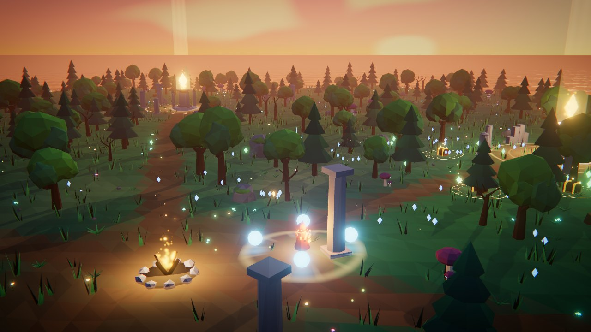
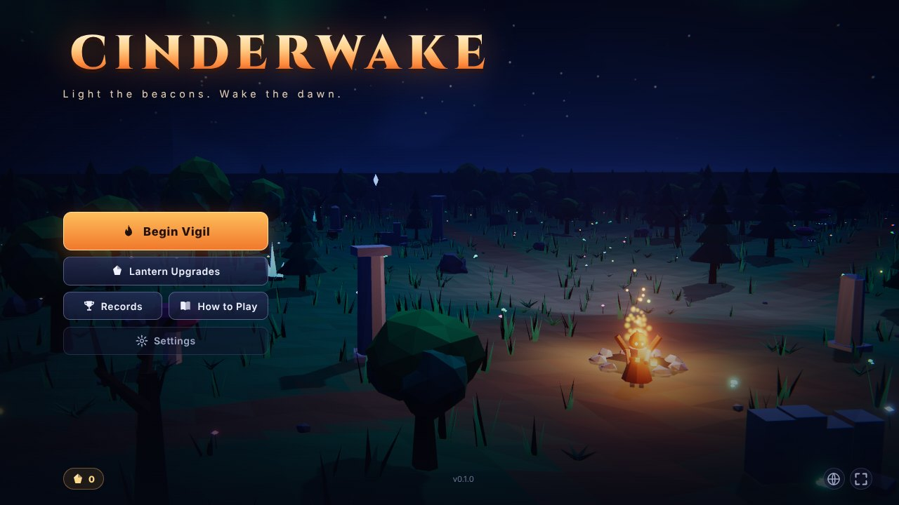
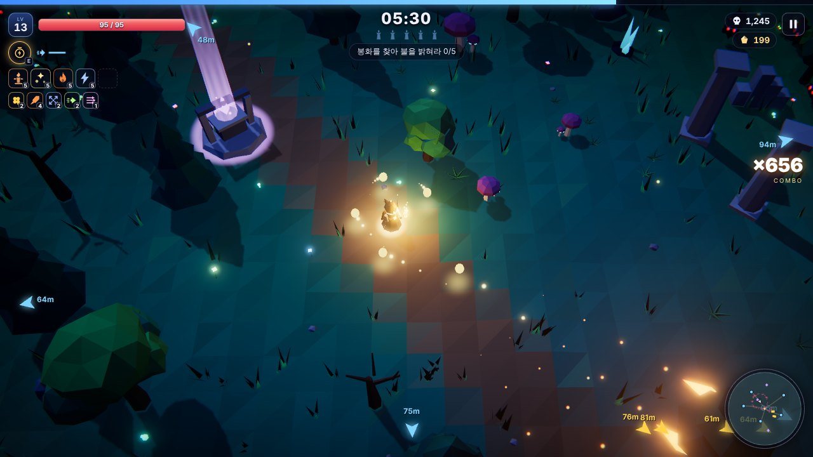
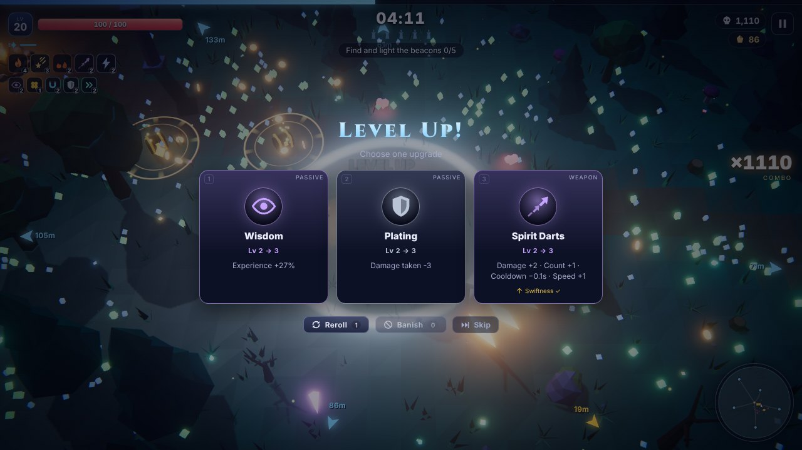
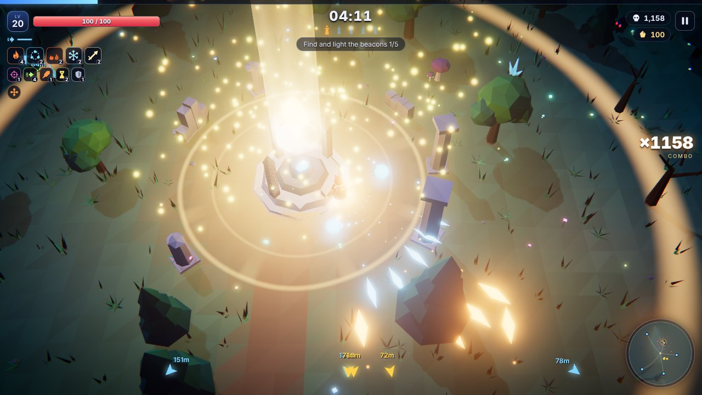
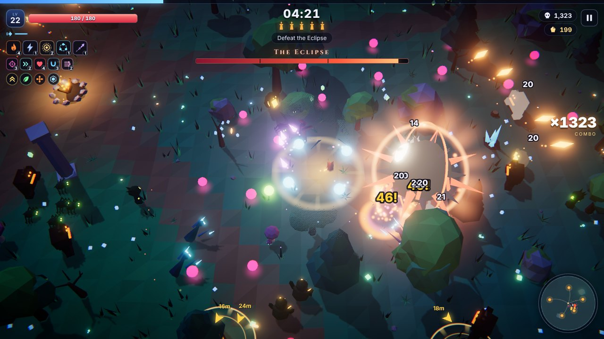
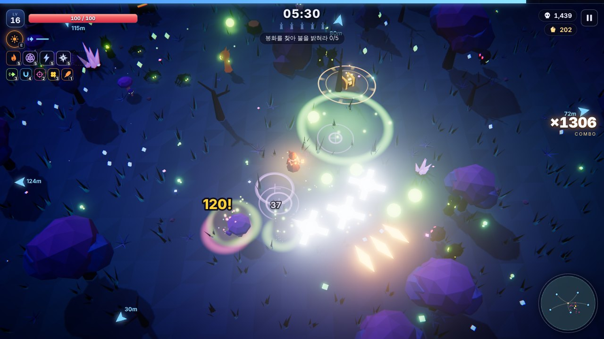
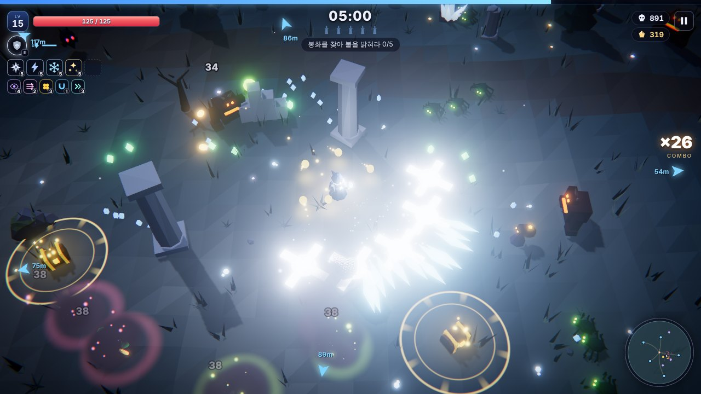

# CINDERWAKE

**봉화를 밝혀, 새벽을 깨워라 — Light the beacons. Wake the dawn.**

브라우저에서 바로 실행되는 3D 액션 로그라이트입니다. 끝나지 않는 밤에 잠긴 섬에서 마지막 등불지기가 되어
다섯 봉화를 밝히고, 밤의 주인 **일식**을 쓰러뜨려 새벽을 되찾으세요.

A 3D action roguelite that runs in the browser. You are the last lightbearer on an isle drowned in endless night:
light five beacons, defeat **the Eclipse**, and bring back the dawn.



> 모델·지형·셰이더·효과음·음악까지 **게임 속 모든 에셋이 코드로 생성**됩니다. 게임이 불러오는 이미지나 오디오 파일은 하나도 없습니다(링크 미리보기 이미지와 앱 아이콘만 예외).
> Every asset — models, terrain, shaders, sound effects and music — is **generated in code**. The game loads no image or audio files (only the link preview and app icons are bitmaps).

## 플레이 / Play

GitHub Pages: **https://nabi-buter.github.io/freefable5.2/**

| | |
| --- | --- |
|  |  |
|  |  |
|  |  |
|  |  |

## 특징 / Features

- **한 판 10~15분**의 밀도 높은 런: 이동·대시 → 자동 공격 → 불씨 수집 → 레벨업 3택 → 봉화 점화 → 유물 → 보스 → 새벽
- **무기 15종**(각 6레벨 + 진화형) · **패시브 14종** · **유물 22종** — 무기와 짝 패시브를 모으면 진화, 무기 둘을 함께 키우면 **시너지 7종**
- **적 12종 + 미니보스 + 3페이즈 최종 보스**, 위협 예산 기반 스폰 디렉터, 접두사가 붙는 정예, 포위 이벤트
- **지역 5곳**: 잿빛 숲 · 서리 호수(서리 폭발, 서리 거인) · 불씨 황무지(용암 분출, 땅속 재벌레) · 달그늘 늪(포자 독안개, 걸어 다니는 독버섯 포자갓) · 폭풍 고원(낙뢰, 번개를 쏘는 뇌운 정령) — 지역마다 적 구성과 지형 위험이 다릅니다
- **일식의 시련**: 빌드를 갖추고 바로 일식과 맞붙어 최단 기록을 겨루는 4분짜리 도전 모드
- **무한 밤**: 일식을 쓰러뜨려도 끝나지 않는 순환 모드 — 봉화가 다시 꺼지고 더 강한 밤이 돌아옵니다
- **잊힌 제단**: 섬마다 숨은 제단 3곳 — 체력을 바쳐 유물을 얻거나, 운명의 동전을 던지는 등 위험과 보상이 걸린 거래
- **서약**: 적 체력·수·속도를 올리거나 회복을 막는 수정자 5종을 골라 걸면 불씨 보상이 최대 2.1배
- **오늘의 도전**: 날짜마다 모두에게 같은 섬·등불지기·지역이 주어지는 일일 모드와 연속 클리어 보상
- **등불지기 8명** — 각자 **고유 능력 2종** 중 하나를 골라 출발(화염 폭발/화염 고리, 벼락/순간이동, 무적 방벽/성역, 광역 빙결/소용돌이, 불길 질주/유인 허수아비, 별비/시간 정지, 과열/불꽃 연발, 탄환 반사/회전 베기) · **난이도 3단계**, 영구 강화 15종, 업적 28개, 도감
- 봉화를 밝힐수록 밤하늘이 조금씩 밝아지고, 보스를 쓰러뜨리면 **실제로 해가 뜹니다**
- 절차적 로우폴리 3D 월드: 시드 기반 섬, 인스턴싱 숲, 바다·하늘·오로라 셰이더, 블룸, 그림자
- **절차적 오디오**: Web Audio로 합성한 효과음과, 전투 강도에 따라 레이어가 쌓이는 생성형 음악
- 키보드·마우스 / 게임패드 / 터치 지원, 한국어·English, 자동 저장, 그래픽 품질 4단계 + 자동 조절, 오프라인 실행(PWA)
- 접근성: 키 재설정, 화면 번쩍임 줄이기, 색각 보조(적 공격 강조색), 진동 켜기/끄기, 화면 흔들림 조절

## 조작 / Controls

| | 이동 Move | 조준 Aim | 대시 Dash | 고유 능력 Ability | 일시정지 Pause |
| --- | --- | --- | --- | --- | --- |
| 키보드·마우스 | WASD / 방향키 | 마우스 | Space / 우클릭 | E / 좌클릭 | Esc / P |
| 게임패드 | 왼쪽 스틱 | 오른쪽 스틱 | A / RB | X / LB | Start |
| 터치 | 화면 왼쪽 드래그 | 자동 | 대시 버튼 | 능력 버튼 | 일시정지 버튼 |

키보드 조작은 설정에서 바꿀 수 있습니다.

레벨업 카드는 숫자 키 `1`–`4`로 고를 수 있고, 마우스 휠로 카메라 거리를 조절합니다.

## 개발 / Development

```bash
npm install
npm run dev      # 개발 서버 (http://localhost:5173)
npm run build    # 타입 체크 + 프로덕션 빌드 → dist/
npm test         # 월드 생성·시뮬레이션 테스트
npm run sim      # 헤드리스 밸런스 봇
```

밸런스 봇은 렌더링 없이 시뮬레이션만 초당 수만 스텝으로 돌려 승률과 진행 속도를 측정합니다.

```bash
npx tsx tests/simbot.ts 10 0 all 0.7 ashwood   # 판수 난이도 캐릭터 실력 지역
```

### 구조

- `src/sim/` — 렌더링과 분리된 순수 게임 로직 (Node에서 그대로 실행)
- `src/render/` — three.js 렌더러, 절차적 모델, 셰이더, 파티클
- `src/audio/` — 효과음 합성과 생성형 음악
- `src/ui/` — DOM 기반 메뉴·HUD
- `src/core/` — 입력, 세이브, 다국어, 업적

자세한 내용은 [`docs/HANDOFF.md`](docs/HANDOFF.md)를 참고하세요.

### 배포

`main` 또는 개발 브랜치에 푸시하면 `.github/workflows/deploy.yml`이 빌드·테스트 후 GitHub Pages로 배포합니다.
저장소 **Settings → Pages**의 Source가 *GitHub Actions*여야 하고, 기본 브랜치가 아닌 브랜치에서 배포하려면
**Settings → Environments → github-pages → Deployment branches**에 해당 브랜치를 추가해야 합니다.

## 기술 / Tech

[three.js](https://threejs.org/) · TypeScript · Vite · Web Audio API · 글꼴 [Cinzel](https://fonts.google.com/specimen/Cinzel) (SIL OFL)

## 라이선스 / License

MIT — [LICENSE](LICENSE)
